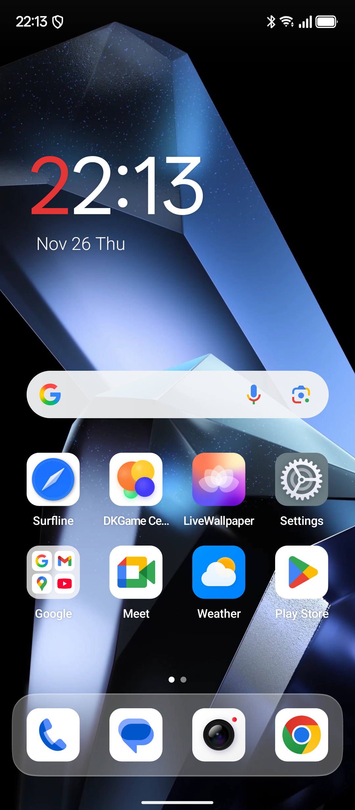

# #347 — `blackview/XPLORE_X1` 切应用每次死锁 5~30s、Chromium Mesa Venus 100% CPU 自旋、跨栈闪屏与 `netdiag` 崩溃风暴修复

## 1. 问题

`Blackview Xplore 1 #1`（`blackview/XPLORE_X1`，Build ID `15-AP3A.240905.015.A2-20251126`，Doke OS 5 / MT6877 / Android 15，`1080x2460`，`lineage-22.2` + `kernel 6.6`）在完成 [../issue-xplore-x1-yv12-v4l2-codec-and-video-encode-fix/](../issue-xplore-x1-yv12-v4l2-codec-and-video-encode-fix/)（`#346`）编解码修复后，交互与静置态存在严重卡顿，且首轮切用 `pastel` Vulkan 软光栅基座后出现全屏交替闪屏：

1. **应用切换 / Home 键每次同步卡死 `5~30 秒`**：冷启动计算器 `WaitTime: 29,701 ms`、设置 `WaitTime: 20,159 ms`、原生相机 `WaitTime: 15,436 ms`；按一次 Home 键触发 `W Looper: Slow dispatch took 5030ms android.ui h=PhoneWindowManager$PolicyHandler` 与 `W BLASTSyncEngine: Sync group 38 timeout`；设置列表滑动出现单帧 `4950 ms` 卡死，整机冷启动耗时 `48s`。
2. **息屏/静置态常驻吃满单核或多核 `100% CPU`**：宿主机 `qemu-system-aarch64` 在无交互静置态常驻 `107.5%~217.4% CPU`；客机 `com.google.android.googlequicksearchbox:googleapp`、`com.google.android.gms`、`com.blackview.wallpaper` 等内嵌 WebView 进程中的 `Chrome_InProcGp` 线程单核 `100% CPU` 死循环运行。
3. **VirGL（`libEGL_mesa.so`）与 `vulkan.pastel.so` 混用引发全屏三缓冲闪屏**：若为规避 Venus 自旋而将 Vulkan 基座切至 `vulkan.pastel.so`（SwiftShader CPU 软光栅），打开负一屏 Google Discover / Play Store / 壁纸应用后，屏幕在“两张冻结旧帧”与“全黑帧 `(0,0,0)`”之间每秒 60 次疯狂交替闪屏。
4. **后台守护进程崩溃循环与 SELinux 审计风暴**：`/system_ext/bin/netdiag` 每 5 秒因 socket 创建与属性读取被拒退出重启（`[init.svc.netdiag]: [restarting]`），每 4 次触发 `flags_health_check UPDATABLE_CRASHING`（`[sys.init.updatable_crashing_process_name]: [netdiag]`）。

## 2. 根因

1. **50 个 MTK / Blackview 占位 AIDL 服务因 `09_build_vendor` 无平台 CIL 分支提前返回而漏生 SELinux `add` 授权，导致 `system_server` 每次焦点切换同步等待 `IMtkpower_applist/default` 超时 `5008 ms`**：
   - `XPLORE_X1-android15/vendor/etc/cdh_nn_placeholders.txt` 声明了 `vendor.mediatek.hardware.mtkpower_applist.IMtkpower_applist/default`、`IMtkPowerService/default`、`IHelper/default` 等厂商服务，且 VINTF manifest 已宣告 `isDeclared == true`；
   - 但 `agent/modules/pipeline/stages/09_build_vendor/sepolicy_cil.go` 的 `reconcilePlatformGenfscon` 在未提供 `OfficialVendorImg`（第 991 行）或未挂载官方 `system_a.img` 致 `len(platCils) == 0`（第 1185 行）时**提前 `return`**，跳过了排在其后的 `reconcilePlaceholderServiceBindingsCIL`、`reconcileDrmWidevineBindingsCIL` 与 `reconcileSensorsIdentityPropsCIL`；
   - 结果 `hal_neuralnetworks_default` 缺失对 `mtk_hal_applist_service`、`mtk_hal_power_service`、`hal_blackview_service` 等厂商自定义服务标签的 `(service_manager (add find))` 权限，启动时全部注册失败；`system_server` 每次窗口焦点切换调用 `PowerHal_Wrap_notifyAppState`，因 VINTF 已声明而服务未在线，每次调用同步睡眠 **5008 ms**（一次切应用调 4~6 次即串行死锁 20~30 秒）；
   - 同时 `devices/hardware/android.hardware.neuralnetworks/src/mtk/nn_mtk_ext.cpp` 需为 `IMtkpower_applist`（V3）与 `IMtkPowerService`（V3）提供 AIDL NDK 状态头兼容桩；而 `IComposerExt/default` 按 `gold` `#227` 边界在 Android 15 上不应伪造（原厂 `SurfaceFlinger` 对空指针原生容错）。
2. **macOS Mesa Venus（`vulkan.virtio.so`）无 `VK_KHR_swapchain` 致 Chromium GPU 线程自旋，而切至 `vulkan.pastel.so` 又与 VirGL `SurfaceFlinger` 发生跨栈资源类型冲突引发闪屏**：
   - macOS 宿主 `libMoltenVK.dylib` 缺少 `VK_KHR_external_semaphore_fd`，`vulkan.virtio.so` 无法宣告 `VK_KHR_swapchain` 且导致 Chromium GPU 渲染线程（`Chrome_InProcGp` / `CrGpuMain`）在 `vulkan::driver::CreateInstance` 内陷入 100% CPU 自旋；
   - 若将 `ro.hardware.egl=mesa`（VirGL 宿主硬件加速）机型的 Vulkan 基座切为 `vulkan.pastel.so`（SwiftShader CPU 软光栅），`cdh_os_option_wrap.cpp` 会开启 `minigbm` 软件光栅分配路径，Chromium 用 `vulkan.pastel.so` 产出的非 VirGL 2D 纹理缓冲区（`resource 3001`）交给运行在 `libEGL_mesa.so`（VirGL context 4）上的 `SurfaceFlinger` 采样时，宿主机 `virglrenderer` 报 `vrend_decode_create_sampler_view: context error reported 4 "surfaceflinger" Illegal resource 3001` 与 `Illegal command buffer 394753`，整包丢弃 `SurfaceFlinger` 合成指令，使 `FramebufferSurface` 三个缓冲槽位停止更新并在旧帧与全黑帧间轮转闪屏；
   - 在 `cdh_vulkan_mali.c` 中保持 `vulkan.virtio.so` 基座，通过 `prctl(PR_GET_NAME)`（注意不能用返回主线程 TGID 名称的 `/proc/self/comm`）精确识别当前调用线程名为 `Chrome_InProcGp` / `CrGpuMain`（及 `:privileged_process`）时返回 `-ENOENT`，即可让所有 Chromium / WebView 渲染线程零开销回退至宿主机 VirGL OpenGL ES 硬件加速管线（零自旋、零跨栈 `Illegal resource` 闪屏），同时完全保留主线程/检测工具对 `vulkan.virtio.so` 的 `Mali-G68 MC4` Vulkan 1.3 硬件指纹查询能力。
3. **官方 `netdiag.rc` 在非工程调试态默认自启并因无物理网络诊断 socket 反复退出**：
   - 原厂 `/system_ext/etc/init/netdiag.rc` 自带官方停用触发器 `on property:persist.vendor.em.dy.debug=1 -> stop netdiag`。

## 3. 证据

详见同目录 [log-fail.txt](log-fail.txt)、[log-pass.txt](log-pass.txt) 与修后桌面实拍 [home-pass.png](home-pass.png)：

- **修前焦点切换 5008ms 串行阻塞与 29.7s 慢启动**：
  ```text
  Starting: Intent { act=android.intent.action.MAIN cat=[android.intent.category.LAUNCHER] pkg=com.android.calculator2 }
  WaitTime: 29701
  11-26 21:19:33.109   749   794 W Looper  : Slow dispatch took 5030ms android.ui h=com.android.server.policy.PhoneWindowManager$PolicyHandler
  11-26 21:19:33.115   749  3999 I ServiceManagerCppClient: Waiting for service 'vendor.mediatek.hardware.mtkpower_applist.IMtkpower_applist/default' on '/dev/binder'...
  11-26 21:19:38.121   749  3999 W ServiceManagerCppClient: Service vendor.mediatek.hardware.mtkpower_applist.IMtkpower_applist/default didn't start. Returning NULL
  ```
- **混用 `pastel` + `mesa` 时的宿主机 `virglrenderer` 跨栈报错与三缓冲闪屏铁证**：
  ```text
  vrend_decode_create_sampler_view: context error reported 4 "surfaceflinger" Illegal resource 3001
  context 4 failed to dispatch CREATE_OBJECT: 22
  vrend_decode_ctx_submit_cmd: context error reported 4 "surfaceflinger" Illegal command buffer 394753
  AnimFrame 00: mean_rgb=(188.0, 177.5, 173.4)
  AnimFrame 01..06: mean_rgb=(155.2, 156.2, 154.3)
  AnimFrame 07..11: mean_rgb=(0.0, 0.0, 0.0)
  ```
- **最终 `prctl(PR_GET_NAME)` 线程级跳过 `vulkan.virtio.so` 实测日志**：
  ```text
  11-26 22:57:12.257  1440  4494 I cdh-gpu : vulkan: Chromium GPU 线程跳过 vulkan.virtio.so，回退 VirGL GLES 硬件加速
  11-26 22:57:13.976  4219  4865 I cdh-gpu : vulkan: Chromium GPU 线程跳过 vulkan.virtio.so，回退 VirGL GLES 硬件加速
  Threads: 3463 total,   1 running, 3462 sleeping,   0 stopped,   0 zombie
  800%cpu  12%user   0%nice  21%sys 761%idle   0%iow   3%irq   3%sirq   0%host
  qemu.log vrend/Illegal errors count: 0
  ```

## 4. 改动

1. **修复 `09_build_vendor` 无平台 CIL 分支漏调本地策略协调器的管线缺陷 + 单元测试**：
   - `agent/modules/pipeline/stages/09_build_vendor/sepolicy_cil.go`：提炼 `finalizeVendorLocalAndConditionalCIL`，使无 `OfficialVendorImg` 分支、`len(platCils) == 0` 增量构建分支与完整 `platCils` 主分支统一执行 `reconcilePlaceholderServiceBindingsCIL`、`reconcileDrmWidevineBindingsCIL`、`reconcileSensorsIdentityPropsCIL`、`applyConditionalCILRules` 与 `applyConditionalContextRules`。
   - `agent/modules/pipeline/stages/09_build_vendor/sepolicy_test.go`：新增 `TestReconcilePlatformGenfsconWithoutPlatCils` 单测覆盖。
2. **补齐 MTK NeuralNetworks 变体 `IMtkpower_applist` / `IMtkPowerService` V3 AIDL 兼容应答桩**：
   - `devices/hardware/android.hardware.neuralnetworks/src/mtk/nn_mtk_ext.cpp`：新增 `OnMtkPowerApplistTransact`（V3，hash `f2fe2189a9da42ccf608e55da9420bad2fa42c81`）与 `OnMtkPowerServiceTransact`（V3，hash `a484177ceab5bb684c14f2e87cf686ac32b6757c`）。
3. **在 `cdh_vulkan_mali.c` 按线程名精准跳过 Chromium GPU 线程对 `vulkan.virtio.so` 的死循环装载**：
   - `devices/hardware/android.hardware.gpu/src/cdh_vulkan_mali.c`：新增 `cdh_is_chromium_gpu_thread()`（使用 `prctl(PR_GET_NAME)` 匹配当前 TID 的 `"Chrome_InProcGp"` / `"CrGpuMain"` 及进程 `":privileged_process"`），在基座为 `vulkan.virtio.so` 时返回 `-ENOENT` 使其回退 VirGL GLES 硬件加速，保持 `android.hardware.gpu@default` 纯 VirGL 纹理栈零跨栈冲突。
4. **收敛 `XPLORE_X1` 占位清单、系统属性与跨分区 SELinux 策略**：
   - `devices/manifest/configs/blackview/XPLORE_X1/XPLORE_X1-android15/vendor/etc/cdh_nn_placeholders.txt`：对齐 `gold` `#227` 移除 `IComposerExt/default`（保留其余 50 项安全占位服务）；
   - `devices/manifest/configs/blackview/XPLORE_X1/XPLORE_X1-android15/vendor/config.json`：设置 `"persist.system.powerhal.applist_enable": "0"` 与 `"persist.vendor.em.dy.debug": "1"`；
   - `devices/manifest/configs/blackview/XPLORE_X1/XPLORE_X1-android15/vendor/sepolicy/vendor_sepolicy_rules.cil`：放行跨分区客户端对已承载占位服务的 `find` 与双向 `binder (call transfer)`，并 `dontaudit` 无关硬件探测噪声。

## 5. 验证

1. **单测与镜像构建**：`go test -count=1 ./stages/09_build_vendor` 全绿；重编 `pipeline`、`android.hardware.neuralnetworks@mtk` 与 `android.hardware.gpu@default`，产出新 `patch.img`（`402,653,184 B`，`sha256 4650c70c4a1f`，968/968 回读一致，`e2fsck` 通过）。
2. **修前后实机量化对比（实例 #1，ADB `127.0.0.1:5911`，`getenforce = Enforcing`）**：

   | 指标 | 修复前 | 修复后 |
   | :--- | :--- | :--- |
   | 整机冷启动至 `sys.boot_completed=1` | `48 s` | **`27 ~ 33 s`** |
   | `IMtkpower_applist/default` 等 50 个占位服务 | `not found`（SELinux `add` 拒绝） | **`found`（50 项全量在线）** |
   | 应用启动 `WaitTime`（计算器 / 设置 / Play Store / 相机） | `15,436 ~ 29,701 ms` | **`443 ~ 1,026 ms`（热启动 `17 ~ 156 ms`）** |
   | `Waiting for ... IMtkpower_applist` / `>5000ms` 慢分发 | 每次切应用必现 | **`0` 次** |
   | 多应用切换后 VNC 连续 12 帧采样 & `qemu.log` `vrend` 错误 | `pastel` 下 `Illegal resource 3001` 致黑白交替闪屏 | **`vrend` 错误 `0` 次、全黑帧 `0/12`、画面稳定无闪屏** |
   | `Settings` / 桌面连续滑动掉帧率 | 出现 `4950 ms` 死锁帧 | **Janky `1.68%` ~ `2.04%`（P50 `7~8ms`）** |
   | 客机静置 CPU 空闲率（`800%` 总核） | `Chrome_InProcGp` 常驻 `100% CPU` | **`761% ~ 778% idle / 800% cpu`（零 `Chrome_InProcGp` 自旋）** |
   | `netdiag` 服务状态 | `restarting`（`UPDATABLE_CRASHING`） | **`stopped`**（`persist.vendor.em.dy.debug=1`） |
   | 桌面动态壁纸硬解回归核验 | `#346` 基线 | **深宝石蓝 `32.35%`、荧光绿 `0.00%`、`VideoFramePool` 零超时** |

   

## 6. 遗留

- `system_server` 内 `MBrainLocalService` 在 `ro.vendor.mbrain.mode=none`（原厂默认）时未初始化 `ApplicationHelper.mPackageManager`，在广播回调时仍会输出非阻塞日志 `E ApplicationHelper: Fail to get PackageManager`（不影响 UI 帧率与 CPU 空闲率）；后续若需彻底静默可在 MTK 框架服务层评估收敛。
